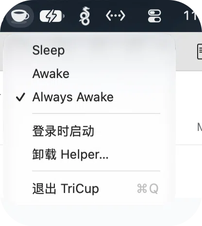

# TriCup

**一个极简的 macOS 菜单栏防休眠工具**：用一个咖啡杯图标的填充程度表示三种状态，一次点击完成切换。无主窗口、无 Dock 图标、无第三方运行时依赖。


- 最低系统：macOS 15
- 架构：Apple Silicon（arm64）
- 协议：MIT
- 版本：**v1.0.0**

---

## 三种状态

| 状态 | 图标 | 行为 |
| --- | --- | --- |
| **Sleep（空杯）** |  | 允许系统、显示器与合盖休眠 |
| **Awake（半杯）** |  | 系统与显示器保持唤醒，**允许**合盖休眠 |
| **Always Awake（满杯）** |  | 系统持续运行，**合盖也不休眠** |

- **左键**点击图标：空杯 → 半杯 → 满杯 → 空杯 循环。
- **右键**：原生菜单，可直接选择三态、登录时启动、卸载 Helper、退出。
- **悬停**：显示当前状态与说明。
- 默认以空杯启动；不自动恢复上次满杯（更安全）。



---

## 下载与安装

从 [Releases](https://github.com/fb0sh/TriCup/releases) 下载 `TriCup.app.zip`：

1. 解压后把 `TriCup.app` 拖入 `/Applications`。
2. 首次打开会被 Gatekeeper 拦截：在 **系统设置 → 隐私与安全性** 中点击「仍要打开」（或右键 App → 打开）。**不要关闭系统安全保护**。
3. 应用没有 Dock 图标，只在菜单栏出现一个咖啡杯。

> 本应用使用 **ad-hoc 签名、未做 Developer ID 公证**（这是"无需付费开发者账号"的代价）。未来签名策略变化可能影响分发。

---

## 使用要点

- **满杯（合盖不休眠）**：首次进入会请求一次系统管理员授权以安装特权 Helper；之后切换不再输入密码。
- **低电量保护**：电池供电且电量 **≤15%** 时禁止进入满杯；若已在满杯会自动降为空杯并通知。
- **登录时启动**：右键菜单开关（`SMAppService.mainApp`）。
- **合盖再开盖**：状态保持不变；系统唤醒后会自动重新应用当前状态（半杯重申请断言；满杯校验 Helper 租约，断连则降空杯并提示）。

---

## 产品预期行为（状态 × 合盖 × 供电/电量）

低电量阈值固定 **15%**（无设置）。

### 满杯判定（供电 × 电量）

| 供电 | 电池情况 | 能否进入满杯 | 已在满杯时 |
| --- | --- | --- | --- |
| 插电（AC） | 任意 | ✅ 允许 | 保持满杯 |
| 电池供电 | > 15% | ✅ 允许 | 保持；降到 ≤15% 自动退出空杯并通知 |
| 电池供电 | ≤ 15% | ⛔ 禁止（提示） | 自动退出空杯并通知 |
| 电池供电 | 电池信息读取失败（有电池 MacBook） | ⛔ 禁止（fail-closed） | 尝试退出并提示；无法确认则给手动恢复指引 |
| 无内置电池（台式 Mac） | — | ✅ 允许 | 保持，不受电量限制 |

> 低电量保护只作用于**满杯**；空杯、半杯不做电量限制。

### 三态 × 合盖的最终结果

| 状态 | 开盖 | 合盖 + 插电 | 合盖 + 电池(>15%) | 合盖 + 电池(≤15%) / 电池未知 |
| --- | --- | --- | --- | --- |
| 空杯 | 正常；空闲可休眠 | 休眠 | 休眠 | 休眠 |
| 半杯 | 系统 + 显示器保持唤醒 | 休眠（允许合盖休眠） | 休眠 | 休眠 |
| 满杯 | 系统 + 显示器保持唤醒 | 系统继续运行（屏幕灭） | 系统继续运行（屏幕灭） | 不允许维持满杯 → 自动降空杯后休眠 |

### 切换与异常预期

| 场景 | 预期 |
| --- | --- |
| 启动 | 默认空杯（不自动恢复上次满杯） |
| 首次进满杯 | 一次管理员授权安装 Helper；之后切换免密 |
| 授权取消 / 安装失败 / 启用失败 | 保持原状态，弹窗说明原因，图标不谎报 |
| 满杯时 Helper 崩溃 / 连接断开 | 自动降为空杯并提示；**不自动重新申请满杯**；Helper 重启后按恢复记录复位 |
| 合盖再开盖 | 保持原状态；唤醒后重应用（半杯重申请断言；满杯校验租约，断连则降空杯并提示） |
| 退出 / 强制退出 / 重启 | Helper 释放租约并恢复原始 `SleepDisabled`；无法确认时提示手动执行 `sudo pmset -a disablesleep 0` |
| 实际 `SleepDisabled=1`（如其它程序设置） | UI 不宣称"允许休眠"，悬停/弹窗提示并可手动恢复 |
| 卸载 Helper | 仅当确认无活跃租约、无残留恢复记录（root 侧校验）才允许；否则拒绝并保留文件 |

---

## 卸载与手动恢复

- 右键菜单 **「卸载 Helper…」**：仅在已安装时显示；会先确认无活跃租约/无残留记录，再停止并删除 LaunchDaemon 与相关文件。
- 若出现任何异常，可随时手动恢复系统休眠设置：

  ```sh
  sudo pmset -a disablesleep 0
  ```

- 手动卸载 Helper（等效）：

  ```sh
  sudo launchctl bootout system/com.fb0sh.tricup.helper 2>/dev/null || true
  sudo rm -f /Library/LaunchDaemons/com.fb0sh.tricup.helper.plist
  sudo rm -f /Library/PrivilegedHelperTools/com.fb0sh.tricup.helper
  sudo rm -rf "/Library/Application Support/TriCup"
  ```

---

## 安全与信任边界

- **特权 Helper 是独立 root LaunchDaemon**，仅接受 `enable` / `disable` / `status` 三个固定操作；使用绝对路径 `/usr/bin/pmset`、参数数组、无 shell；拒绝任何客户端命令/脚本/路径/参数注入。
- Unix Domain Socket 权限受限（0600，属主为控制台用户），并校验客户端 UID/PID；`proc_pidpath` 仅作辅助校验。
- **同 UID 信任边界**：同一登录用户会话内的进程被视为同一信任域；Helper 的校验用于拒绝跨用户/异常连接，但**不防御已被攻陷的同 UID 进程**。
- 安装脚本固定绝对目标路径、显式 `root:wheel` 所有权与权限、写前检查符号链接、仅对 Helper 二进制最小范围清除 quarantine，且**从不关闭 Gatekeeper**。
- 安装/升级/卸载通过跨进程维护锁 + `uninstalling` 标志与服务端串行化；残留陈旧锁会被安全回收。

## 全局电源设置与残余风险

- 满杯依赖系统级 `pmset -a disablesleep 1`，它是**全局、跨重启**设置。Helper 通过「租约模型 + 启动/崩溃恢复 + 回读验证 + 失败保留记录重试」尽量保证恢复；极端情况（断电、Helper 被杀到重启之间的窗口、终端手动改 pmset、其它软件并发修改）无法绝对保证立即复位。请用手动恢复命令兜底。
- **散热**：合盖运行主要面向**桌面上的后台任务**。请勿把合盖持续运行的 MacBook 放入背包，以免积热/降频。
- 手装 LaunchDaemon 与 `pmset disablesleep` 均非 Apple 官方长期支持接口，未来 macOS 版本可能改变行为或收紧。
- ad-hoc 签名分发需手动放行；同 UID 信任边界如上。

更多设计细节见 [ADR-0001](docs/adr/0001-lid-close-privileged-helper.md) 与 [ADR-0002](docs/adr/0002-wake-reapply.md)。

---

## 稳定性与安全（v1.0.0）

- **电源恢复可验证**：释放失败明确报错，绝不把状态伪装成"允许休眠"；每次切换回读真实 `SleepDisabled`，无法确认时标记"不确定"并给出手动恢复指引。
- **租约持久化严格化**：空文件 / 损坏 JSON / 不支持的版本都会报错并阻止新租约；仅回读验证恢复成功后删除记录。
- **Socket 健壮性**：`SO_NOSIGPIPE`、EINTR/部分读写/EOF/EPIPE、读写超时、连接数上限、请求长度上限、写失败即释放租约；满杯租约长连接不被空闲超时切断。
- **pmset 严格解析**：`pmset -g` 缺失或格式异常一律报错（不再默认 false）；子进程 5 秒超时。
- **电池状态区分**：读取失败与"无电池设备"不再伪装成 AC/100%；有电池但读取失败时 fail-closed。
- **唤醒重应用**：系统唤醒后自动重新应用当前状态，断连则降级不自动重开满杯。
- **版本与产物**：`CFBundleShortVersionString` 从 tag 去除 `v` 并强制数字；CI 校验签名/资源/ZIP 完整性并上传 `TriCup.app.zip`。

---

## 开发与 CI

- SwiftPM + AppKit + IOKit + 独立 Privileged Helper。本地无需 Xcode / 付费账号。
- GitHub Actions（`macos-26`，arm64）执行 `swift build`、`swift test`、Release 打包（ad-hoc 签名）并上传 `TriCup.app.zip`；推 `v*` tag 自动创建 Release。
- CI 不执行任何真实 `pmset`，也不安装特权 LaunchDaemon；CI 构建只读权限，仅 tag 发布任务具备写权限。

手动构建（仅在 macOS 上）：

```sh
swift build
swift test
bash scripts/package.sh   # 产出 tmp/build/TriCup.app.zip
```

---

## 真机验收清单（M4 Air）

- [ ] 空杯：合盖休眠正常。
- [ ] 半杯：`pmset -g assertions` 可见 TriCup 的系统/显示器断言。
- [ ] 满杯：首次安装 Helper 后合盖、拔电仍继续运行。
- [ ] 正常退出 / 强制退出 / `kill -9` → `SleepDisabled` 恢复为进入前值。
- [ ] Helper 崩溃（`sudo pkill -9 -f TriCupHelper`）→ 应用降为空杯并提示，且不自动重试；Helper 重启后恢复。
- [ ] 系统重启 → 恢复（`pmset -g | grep SleepDisabled` 为 0）。
- [ ] 电池 ≤15% → 无法进入满杯；满杯中降到 15% 自动退出。
- [ ] 合盖再开盖：状态保持且唤醒后继续生效。
- [ ] 卸载 Helper：无租约/无残留记录时成功；否则拒绝并保留文件。

---

## 图标与许可

咖啡杯图标复用自 [KeepingYouAwake](https://github.com/newmarcel/KeepingYouAwake)（MIT，© Marcel Dierkes），并新增半杯样式。详见 [LICENSE](LICENSE) 与 [THIRD_PARTY_NOTICES.md](THIRD_PARTY_NOTICES.md)。

本项目以 MIT 协议开源。
